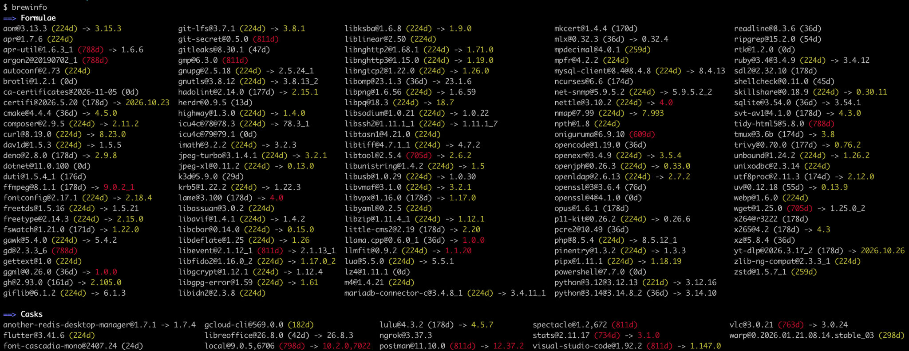

# brewinfo

Same grid as `brew list`, with the version you have and the one Homebrew would install.

```
ffmpeg@8.1.1 (400d) -> 9.0.2_1
aom@3.13.3 (20d) -> 3.15.3
vlc@3.0.21 (700d) -> 3.0.24
dotnet@11.0.100 (3d)
```

`(Nd)` is days since you installed that copy. It comes from the Homebrew receipt, so it resets when you upgrade. It is not the day the version was published, and the version after the arrow has no day count. No receipt, no `(Nd)`.

`brewinfo` only reads. It does not install, upgrade, or remove packages.



## Colors

An arrow means Homebrew's version is newer.

| What changed | How it looks |
| --- | --- |
| First number (`8` to `9`) | New version in red |
| Second number (`3.13` to `3.15`) | New version in yellow |
| Patch, `_N` rebuild, or `,N` cask build | Arrow, normal color |
| You are current, or Homebrew's number is lower | No arrow |
| Installed more than 180 days ago | `(Nd)` in yellow |
| Installed more than a year ago | `(Nd)` in red |

`openssl@3` at `3.6.4` stays without an arrow when the formula is `3.5.9`. That would be a downgrade. A formula that already has `@` in the name keeps it: `python@3.14@3.14.10`.

Color is off if you pipe the output, set `NO_COLOR`, or use `TERM=dumb`.

## Install

You need Homebrew, plus bash 3.2 or zsh 5.

```sh
git clone https://github.com/vmandic/bash-brewinfo.git
cd bash-brewinfo
```

zsh:

```sh
. "$PWD/share/brewinfo.zsh"
brewinfo
```

bash:

```sh
. "$PWD/share/brewinfo.bash"
brewinfo
```

`./bin/brewinfo` runs it without sourcing.

`./install.sh` prints what it would copy into `~/.local` and what it would add to your shell rc. `./install.sh --write` does that, after saving a `*.bak` copy of the rc file. `./install.sh --uninstall` removes the block, the copy, and the `brewinfo` link when that link points at this copy.

The script will not run as root, will not follow a symlink rc file, and will not use a prefix outside your home directory.

Looking up new versions calls `brew outdated`, which talks to Homebrew. The installer does not.

## Notes

Cask versions are read from the Caskroom. `brew list --cask --versions` gives up when one cask is gone from the taps, so this does not use it.

The color follows the first number that differs. `2026-09-25` is read as `2026.09.25`. A lower number is not treated as an upgrade.

If `brew outdated` fails, you still get the installed versions and a warning on stderr.

Agents: [AGENTS.md](AGENTS.md).

## Tests

```sh
./test/run.sh
```

Offline. Same cases in `/bin/bash` and `zsh -f`.

## License

[MIT](LICENSE). Copyright 2026 Vedran Mandić.
